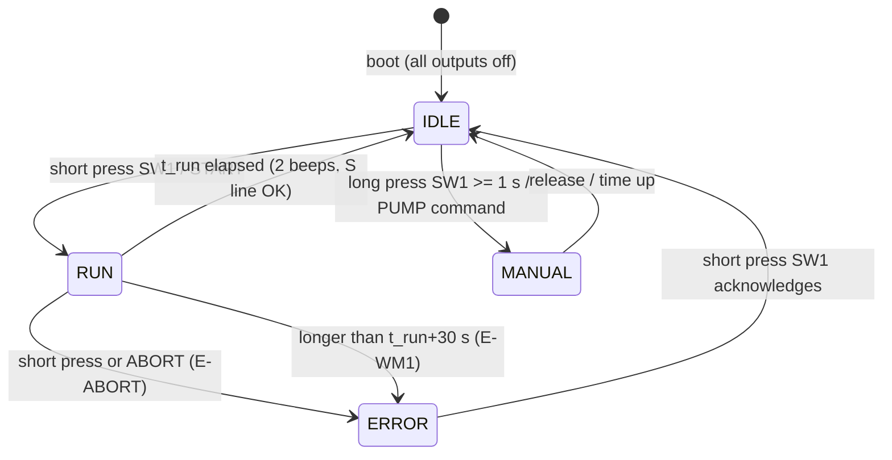
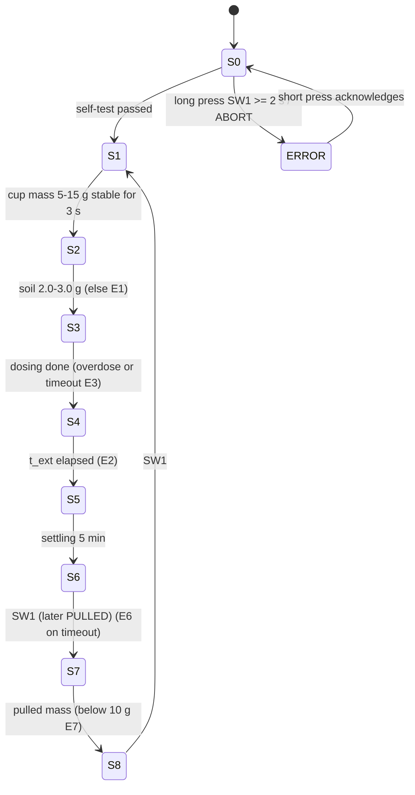
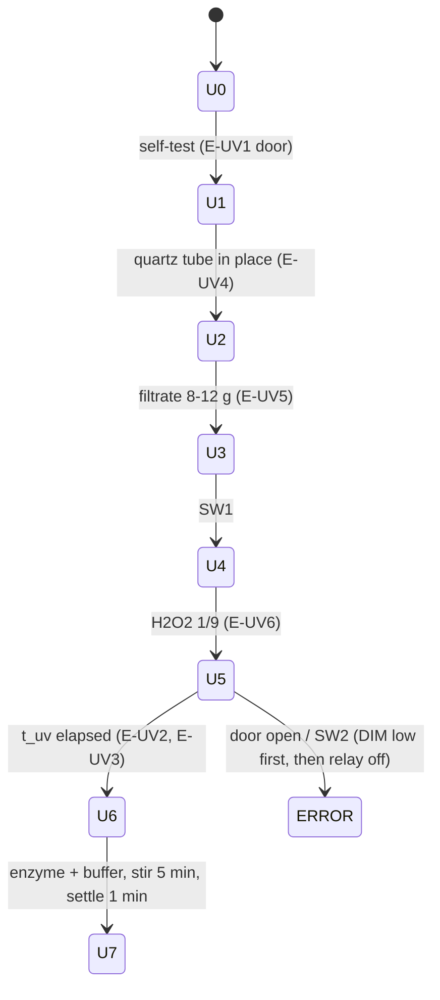

# State machine diagrams

State names and codes match `wm_machine.cpp`, `sm_machine.cpp` and `uv_machine.cpp`. WM is fully implemented; SM and UV are skeletons (see the TODO comments in each file).

## WM (implemented)

## SM (skeleton)

## UV (skeleton)

